<p align="center">
  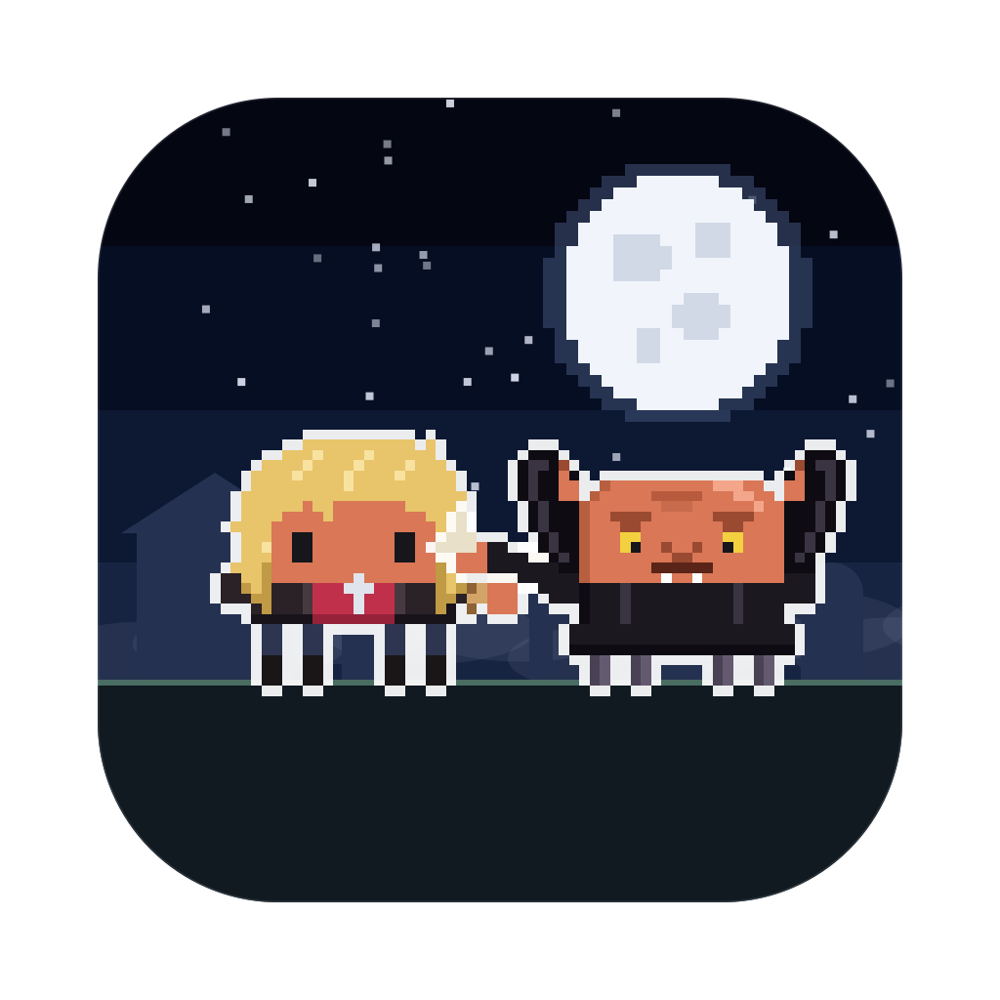
</p>

<h1 align="center">Clawd Slayer</h1>

<p align="center">
  <b>Your AI coding sessions, as a pixel-art vampire hunt on your desktop.</b><br>
  Every session is a hero or a villain of Sunnydale, every subagent joins in, and they fight while they work.
</p>

<p align="center">
  <a href="LICENSE"></a>
  
  
  
  <a href="https://github.com/rodclemen/clawd-clash"></a>
</p>

https://github.com/user-attachments/assets/dd9213e1-7192-4018-b169-ea451f6a146b

<p align="center"><sub>🔊 <b>Click the speaker in the player for sound</b>: GitHub starts videos muted. Full 1080p version: <a href="promo/clawd-slayer-promo.mp4">promo/clawd-slayer-promo.mp4</a></sub></p>

> **Clawd Slayer is a universe of [Clawd Clash](https://github.com/rodclemen/clawd-clash).** Same crew, same fights, more universes to switch to. This page shows off the Clawd Slayer universe; see [Get it](#get-it) to install.

<p align="center">
  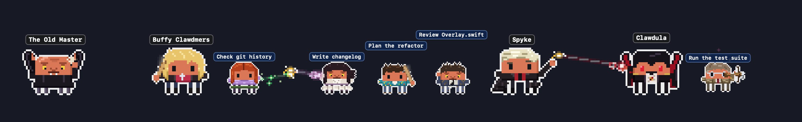
</p>

---

## Contents

- [What it is](#what-it-is)
- [The Clawd Slayer universe](#the-clawd-slayer-universe)
- [The cast](#the-cast)
- [Window mode](#window-mode)
- [Screen saver](#screen-saver)
- [Get it](#get-it)
- [More universes](#more-universes)
- [What's new](#whats-new)

## What it is

You run Claude Code in three terminals. One is thinking, one is waiting for your permission, one finished ten minutes ago and you didn't notice. You alt-tab around to find out.

**Clawd Clash tells you at a glance, without switching windows.** Every session becomes a character in a pixel-art vampire hunt, along the bottom of your screen or in a window of its own: Claude Code's, and those of the other AIs and harnesses Clawd Clash supports ([the full list](https://github.com/rodclemen/clawd-clash#supported-ais-and-harnesses)).

- ⚔️ **Working?** Your Claude swings a stake, a sword, an axe or a 2×4, looses crossbow bolts, or casts a spell.
- 💭 **Thinking?** A thought bubble.
- ❗ **Needs you?** A red `!`, and if you ignore it for a minute, it starts jumping up and down. It keeps asking until you answer; press Esc instead and it stands down.
- 😴 **Done and idle?** It stops fighting and passes the time with habits of its own: Buffy flips the stake up and catches it without looking, Willow floats a pencil off a stack of books, Giles reads a dusty tome and polishes the glasses, Xander hammers nails into a plank, Anya counts the takings at the till, the Potentials stake a training dummy and Lorn sings karaoke. Only the witches (Willow, Tara and Jenny) float cross-legged in meditation. After a couple of minutes it sits down; after five it's asleep (zZz).
- 🧛 **Spawned subagents?** Every subagent gets to be part of the Scoobies (or a vampire, a demon or a fledgling fresh out of the grave): they walk in one by one, each labelled with what it's doing, and leave when they finish.
- 🔍 **Hover** any character for the details: status, how long, the tool it's running, your last prompt.
- 🖱️ **Click** any of them to jump straight to that session's terminal or editor tab.

No dashboard to open, no tab to check. It's just… there. Beep me if the apocalypse comes.

## The Clawd Slayer universe

Run two Claudes and they square off. Every character is Clawd (Claude Code's little pixel mascot) in costume, from Buffy the Vampire Slayer's Sunnydale and the Angel spin-off's Los Angeles, and the fights follow the weapons:

| Matchup | What happens |
|---|---|
| magic (Willow's green ribbon, Dark Willow's red-black lightning, Drusillah's hypnotic stare, the Judge's ray, Ethan Raine's chaos) vs a crossbow or a gun | the shooter gets hit |
| magic vs a stake, sword, axe, 2×4, hammer, claws or fists | the weapon catches it |
| a crossbow or a gun (Giles's crossbow, Darlah's pistols, Riley's taser rifle, Adamm's arm gun, D'Hoffrin's fire) vs a stake, sword, axe, 2×4, hammer, claws or fists | shots fly, and each one gets knocked away into the sky |
| stake, sword, axe, 2×4, hammer, claws or fists vs the same | they close in and fight it out |
| crossbow or gun vs the same | a proper shoot-out: they duck and the shots collide mid-air |
| odd one out | cheers the others on |

Some of them don't fight at all: Dawn, Jonathan, Clemm, Whistlr, Fred, Lorn, the Mayor, Professor Walshe, the First Evil, Quentin Travesty, Principal Snide, Lilah Morgane and Holland Mannerly. The armoured ones (the Judge, the Mayor after the Ascension ritual, Adamm, Preacher Calebb, Tedd, the Knight of Byzantium, Molok, Olaff, the Turok-Hahn, the Stone Beast and more) send shots ricocheting off.

**Arch-enemies face off first.** Whenever a pair is on stage together, everyone else shuffles aside so the two of them can have it out: Buffy and the Old Master, Willow and Glorificlawds, Xander and Dark Willow, Giles and Ethan Raine, Cordelia and Harmony, Ozz and Veruka, Anya and Olaff, Spyke and Clawdula, Faith and Kakistoes, Kendra and Drusillah, Joyce and Tedd, Riley and Adamm, Tara and the Gentlemen, the First Slayer and the First Evil, the Potentials and the Turok-Hahn, Angstel and Holts, Wesley and Lilah, Fred and Illyrya, and more. Angstel and Spyke never lead two sessions back to back.

**The school bus.** When an agent is done, it walks off, unless someone comes to pick it up. The yellow school bus from "Chosen" comes for the Scooby Gang, the Slayers and the Potentials, and its folding door opens onto the steps; Spyke's black DeSoto, its windows painted out and papered over, comes for the vampires; Angstel's black convertible, top down, comes for Angel Investigations. Everyone else walks.

<p align="center">
  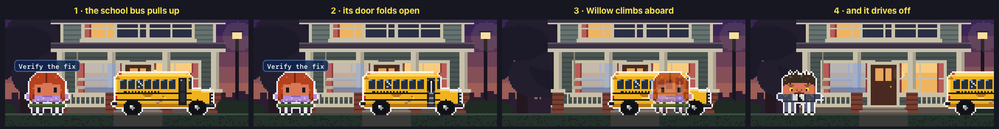
</p>

**Tabula Rasa.** When a session led by one of the eight from that episode (Buffy, Willow, Xander, Giles, Anya, Tara, Spyke or Dawn) compacts its context, Willow's forgetting spell goes off: a crystal glows at their feet and puffs pink smoke, a big "?" rises over their head with who they think they are (*"JOAN?"*, *"RANDY?"*, *"ALEX?"* or *"WHO AM I?"*), then the crystal cracks underfoot and it all comes back.

<p align="center">
  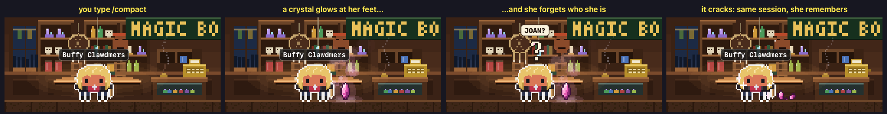
</p>

**The First Evil's guises.** Now and then the First Evil becomes one of the Big Bads before it for a few seconds, whole, still floating: the Old Master, the Mayor, Glorificlawds or Adamm.

<p align="center">
  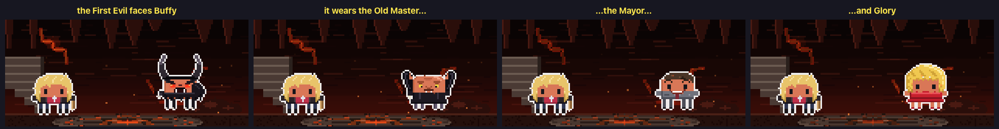
</p>

**Hush.** While the Gentlemen are on stage, nobody has a voice: every speech bubble comes up empty.

**The full moon.** On nights when the real moon is full, Ozz and Veruka stay wolves all night.

**The Mayor's wet wipe.** After every fight on stage ends, Mayor Wilclawds takes out a packet of wet wipes and cleans up, finger by finger (*"Gosh!"*).

**Heroes against villains.** Run Claude Code alongside another AI and they pick sides: Claude Code plays the heroes, the others the villains, and each one's agents fight for their own side. The outline colour round each character tells you which AI it belongs to.

## The cast

48 villains and 35 heroes (plus one rare guest), from Buffy the Vampire Slayer and Angel. Nearly all of them can be a session (drawn large) or an agent (drawn small); Miss Kitty and the small fry only ever come as agents. Every one of them has a signature move, and most have an arch-enemy.

**The heroes**: the Scooby Gang: Buffy Clawdmers (flips the stake up, it turns over twice in the air, and catches it without looking, *"Beep me if the apocalypse comes."*), Willow Rosenclawd (a pencil floats up off one palm and spins, *"Resolve face!"*), Xander Harrows (lets the 2×4 drop and draws a rocket launcher from behind the back, *"I laugh in the face of danger!"*), Rupert Gyles (polishes the glasses, squinting, *"Oh, dear Lord."*), Cordelia Chaise (a vision hits in a white flash, *"Hel-lo?"*), Ozz (wolfs out for a second, *"Hey."*), Anya Jinkins (counts the takings, dollar signs floating up, *"Bunnies!"*), Tara Maclawd (a little ball of lavender light rises out of cupped hands), Spyke (throws a punch and the chip zaps, *"Bloody hell!"*), Dawn Clawdmers (the Key's green energy flickers through) and Joyce Clawdmers (arms folded, a mum's look, *"Have you tried not being a Slayer?"*); the Slayers, Watchers and Potentials: Faith Lehayne (twirls the Mayor's knife, *"Five by five."*), Kendra Yung (holds Mr. Pointy up proudly, *"Mr. Pointy."*), the First Slayer (crouches low with the spear while sand swirls, *"No friends. Just the kill."*), Jenny Clawdlendar (holds up the Orb of Thessulah, and it slowly lights), Principal Robin Woode (a stake slides out of the sleeve and back up it), Kennedie (blows the drill whistle, clipboard up), Vy (pulls the woolly hat down shyly, then peeks back out) and Rhona (rolls the eyes and throws both arms out: so unfair); the Sunnydale friends: Riley Fynn (stands to attention and salutes, *"Ma'am."*), Jonathan Levinsun (the Class Protector umbrella pops open), Clemm (munches cheesy snacks), Whistlr (flips a coin, a knowing grin) and Sid the Dummy (turns the head right round, all the way); Angel Investigations: Angstel (a felt puppet from "Smile Time" for a second, *"We help the helpless."*), Wesley Windup-Pryce (strikes a pose, pistol to the sky, *"Rogue demon hunter!"*), Charles Gunne (spins the hubcap axe), Fred Burkel (scribbles an equation in the air), Lorn (sings karaoke), Doyl (the half-Brachen face shows, blue and spiky), Conner (springs up and lands in a crouch), Kate Lockclawd (holds up the badge), the Groosalug (the sword thrust up over the head, *"Princess!"*) and Drogynn (just stands the watch). Miss Kitty Fanclawdstico, Willow and Tara's kitten, pounces on a ball of red wool. And now and then HEM turns up in a Watcher's tweed jacket and tie, with a wooden stake.

**The villains**: the vampires: the Old Master (presses both hands on the invisible barrier like a mime, *"Here endeth the lesson."*), Lukewarm (preaches, arms spread wide), Darlah (twirls two pistols), Drusillah (holds up Miss Edith and sways, *"Naming all the stars."*), Mr. Tricks (straightens the gold tie), Harmony Clawdall (the hair flip, *"Blondie Bear!"*), Kakistoes (stamps a hoof and the ground cracks), Sundae (snaps the Class Protector umbrella in two), Lyle Grouch (spins a lasso over the hat), Clawdula (turns to mist with two red eyes in it) and the Turok-Hahn (throws up its arms and roars); the Big Bads: the Judge (one blue hand crackles), Mayor Wilclawds (wet wipes, finger by finger, *"Gosh!"*), Adamm (the chest plates swing open on the glowing core), Professor Walshe (ticks off line after line on a clipboard), Glorificlawds (admires the shoes and flickers into Ben, *"I'm a god!"*), the First Evil (its face flickers through the Big Bads before it, *"From beneath you, it devours."*), Preacher Calebb (rolls up a sleeve and cracks the knuckles) and Dark Willow (the letters lift off a book's page and stream up the arms, *"Bored now."*); henchmen, rivals and monsters of the week: a Bringer (just waits), a Knight of Byzantium (raises the shield, a gleam across it), Dok (a forked lizard tongue flicks out), the Gentlemen (a silent, polite golf clap), Andrew Wellz (films it all on a camcorder), Ethan Raine (holds up the bust of Janus), Sweete (a soft-shoe with the cane), Tedd (*"Mini pizza?"*), Molok (green text scrolls faster and faster across the chest), Olaff the Troll (raises the hammer like a toast, *"Ale!"*), D'Hoffrin (swings the talisman on its chain), Halfreck (the demon face and a burst of pink sparkles, *"Wish granted!"*), Veruka (howls, a wolf for a second), Gwendolyn Poste (the Glove of Myhnegon crackles), Quentin Travesty (unrolls a ruling and reads it out) and Principal Snide (wags a finger, *"Watching you."*); Wolfram & Hart and Angel's foes: Lindsey McDonclawd (picks out a few notes on the guitar), Lilah Morgane (flicks the briefcase open on a contract), Holland Mannerly (offers a hand with a warm, terrible smile), Jazzmine (the gold light bows down, *"Love me."*), the Stone Beast (the sky darkens and the rain of fire drifts down), Holts (doesn't show off), Sahjhann (flickers out of phase), Illyrya (slows time, dust hanging still in the air) and Skipp. And the small fry, only ever agents: a fledgling vampire just out of the grave, one of Glory's minions (bows and scrapes), Gachnar (*"Fear me!"*) and Amy the rat.

<p align="center">
  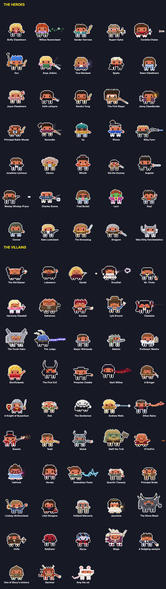
</p>

## Window mode

Clawd Clash opens in a window by default (switch to the desktop from the menu). The whole crew stands in a scene, and every session gets a card: its project, what it's doing right now, your last prompt, its last reply, and its agents in a little tree underneath.

<p align="center">
  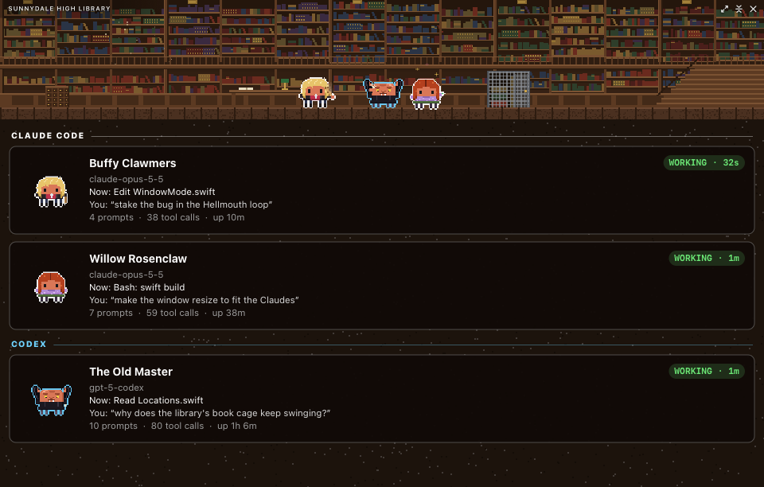
</p>

The scene is set **where the first session's character belongs**: the Sunnydale High Library for Buffy, Willow, Xander and Giles, the Bronze for Faith and Harmony, Restfield Cemetery for Kendra and the graveyard vampires, Spyke's crypt for Spyke, the Magic Box for Anya and Tara, the sunken church for the Old Master, the Hyperion Hotel for Angel Investigations, Wolfram & Hart for its lawyers:

<p align="center">
  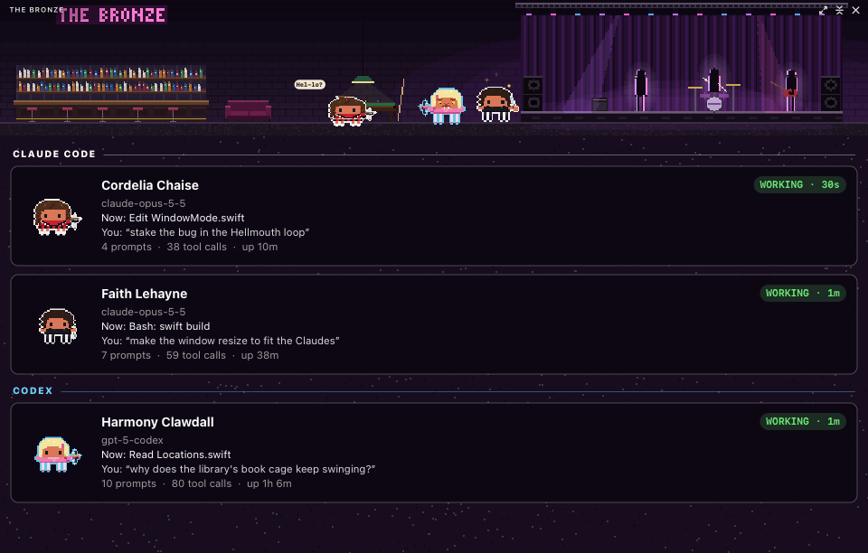
</p>

20 hand-built places, each with its own little animation: dust turns in the light in the Sunnydale High Library and the Hellmouth's red glow seeps up between the floorboards; the band plays in silhouette under sweeping stage lights at the Bronze; mist rolls over Restfield Cemetery and a pale hand claws up out of a fresh grave; the TV flickers in the window of 1630 Revello Drive; incense curls up and a crystal turns in the Magic Box; a soap opera plays on the TV in Spyke's crypt; water drips into the pool in the sunken church; the cracks pulse red over the Hellmouth; autumn leaves blow across UC Sunnydale; a hostile paces behind the force fields in the Initiative; green energy crawls up Glory's tower; the brazier leaps in the factory; the neon OPEN buzzes at the Doublemeat Palace; headlights sweep across the Welcome to Sunnydale sign; the sun comes up over the crater; heat shimmers over the dream desert; the lift gate folds open at the Hyperion; the disco ball turns at Caritas; and the city's windows light and go dark below Wolfram & Hart.

<p align="center">
  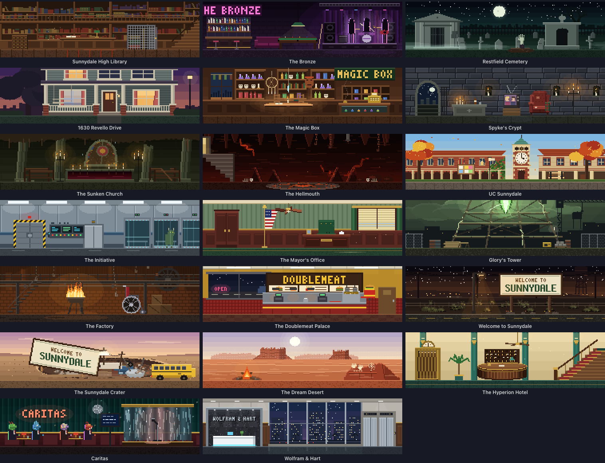
</p>

When the scene moves somewhere new, it goes the way the show would: a stake strikes and the old place blows away as dust; a Watcher's tome thuds down and its pages turn to the new place; Willow's spell spirals in through a circle of candles; Dark Willow's black veins crawl in from the edges ("Bored now", only with Dark Willow on stage); the Hellmouth splits open and swallows the old place; the Gentlemen float across and every voice drifts into a box (Hush, only with them on stage); the red curtains of "Once More, With Feeling" close and open again; sunrise burns the old place off; the Key's portal tears open; a long black coat swishes past; the lift at Wolfram & Hart counts the floors and dings; the desert sand of "Restless" blows across, the First Slayer's painted face looming out of it; and, rarest of all, the opening titles, CLAWD SLAYER with a stake for a stroke. Each comes up more often with its own people on screen, or when it's heading for its own part of town.

<p align="center">
  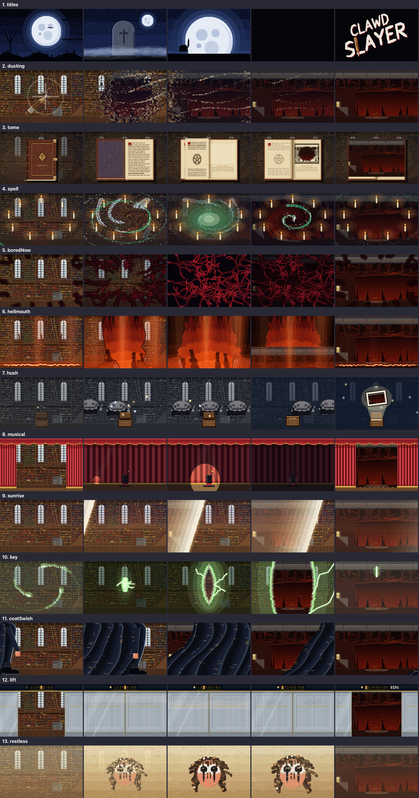
</p>

## Screen saver

<p align="center">
  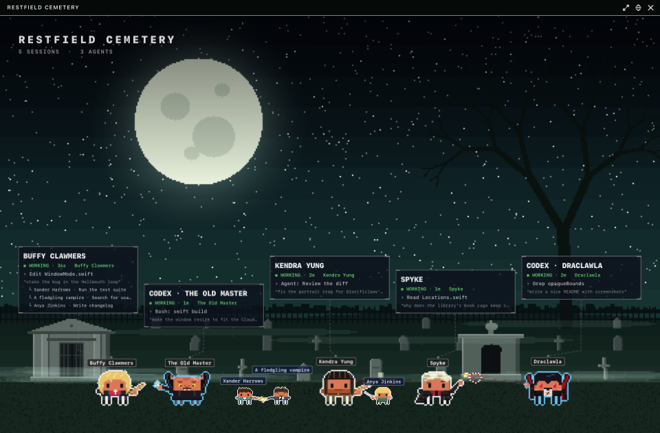
</p>

Clawd Clash comes with a screen saver: the place at full screen and the crew fighting across its floor. Every Claude and agent wears a name tag, each session has a card floating above the crew, a clock sits in the corner, and what happened lately crawls along the bottom. Every 10 minutes it travels somewhere new with one of the transitions above. When there's nothing much to watch, it puts on a show instead: a random crew squaring off, heroes against villains. It even shows your sessions with the app closed. Pick **Clawd Slayer** in the screen saver's **Options…** in System Settings.

The window can show the same view, and **Random** location moves the window somewhere new every 10 minutes, the same way.

## Get it

Clawd Slayer is part of **[Clawd Clash](https://github.com/rodclemen/clawd-clash)**, one app with multiple universes. It needs macOS 13+ and at least one of the [AIs and harnesses it supports](https://github.com/rodclemen/clawd-clash#supported-ais-and-harnesses).

It comes with Clawd Clash 3.7.0 and later. With Homebrew:

```sh
brew tap rodclemen/tap
brew trust rodclemen/tap      # newer Homebrew asks you to trust a third-party tap once
brew install --cask clawd-clash
```

Then pick **Settings → Universe → Clawd Slayer** (already have Clawd Clash? `brew upgrade --cask clawd-clash`). Or download the zip from [Clawd Clash's releases](https://github.com/rodclemen/clawd-clash/releases), unzip it and drag **Clawd Clash** to Applications.

Everything else (how it works, the settings, uninstalling, the source and contributing) lives in the **[Clawd Clash repo](https://github.com/rodclemen/clawd-clash)**.

## More universes

Clawd Slayer is one of multiple universes. In **Settings → Universe** you can switch to **[Star Clawds](https://github.com/rodclemen/star-clawds)**, **[Marvelous Clawds](https://github.com/rodclemen/marvelous-clawds)**, **[Detective Clawds](https://github.com/rodclemen/detective-clawds)**, **[Doctor Clawd](https://github.com/rodclemen/doctor-clawd)**, **[The Clawd Files](https://github.com/rodclemen/the-clawd-files)**, **[Stevie Clawdberg](https://github.com/rodclemen/stevie-clawdberg)** or **[Clawd of the Rings](https://github.com/rodclemen/clawd-of-the-rings)**, or pick **Random** to change universe on its own every so often. Switching recasts everyone on screen and moves the scene to one of the new universe's places. Or pick **Clawd Royale** to throw every cast into one scene, each character as themselves, in a new place from any universe every ten minutes.

## What's new

The highlights, in plain words: [CHANGELOG.md](CHANGELOG.md). The full history lives in Clawd Clash.

---

<p align="center"><sub>An independent parody fan project, not affiliated with or endorsed by 20th Television, Mutant Enemy Productions, The Walt Disney Company or the makers of Buffy the Vampire Slayer or Angel. Claude and Clawd belong to Anthropic.<br>Free to use: <a href="LICENSE">MIT licensed</a>.</sub></p>
